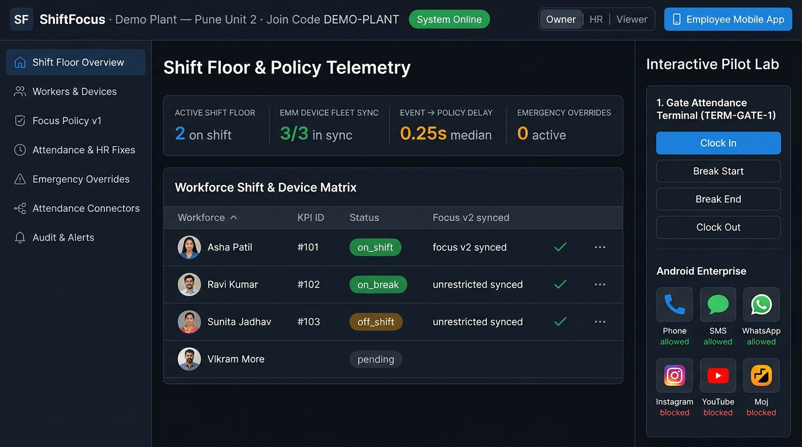
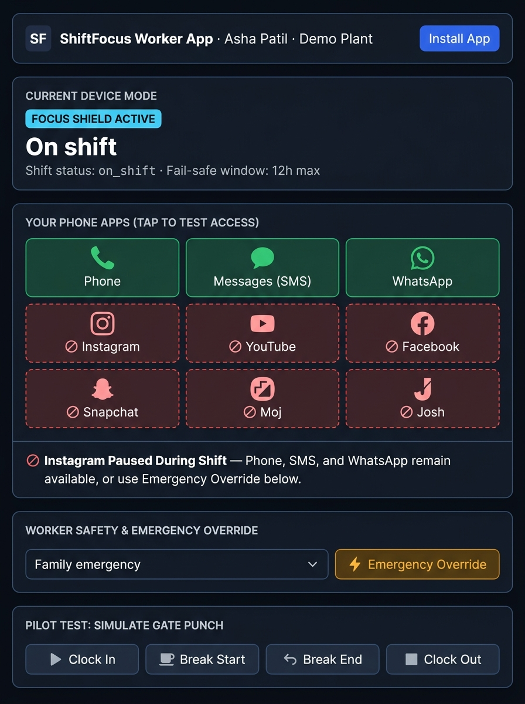
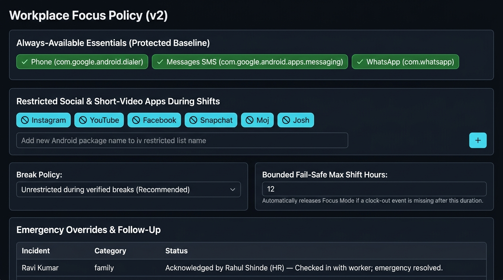

# ShiftFocus

**Attendance-linked focus controls for industrial workplaces.**

ShiftFocus is an attendance-linked focus management system designed for industrial workplaces where personal social or short-video app use during active shifts may interrupt tasks and contribute to operational delays. When a workplace's attendance system confirms a worker's `clock_in`, ShiftFocus applies a clearly disclosed focus policy to their enrolled Android handset; a verified `break_start` temporarily lifts (or modifies) restrictions, and `clock_out` restores normal access.

> **Live Hosted Pilot Deployment:**
> - **Admin Console & Interactive Pilot Lab:** [https://shiftfocus-6gaz.onrender.com/](https://shiftfocus-6gaz.onrender.com/)
> - **Installable Employee Mobile App (PWA):** [https://shiftfocus-6gaz.onrender.com/worker](https://shiftfocus-6gaz.onrender.com/worker)
> - **API Health Check:** [https://shiftfocus-6gaz.onrender.com/v1/health](https://shiftfocus-6gaz.onrender.com/v1/health)

[](https://render.com/deploy?repo=https://github.com/jagtapyogesh41/workfocus)

---

## Application Screenshots & Visual Tour

### 1. Shift Floor Overview & Interactive Pilot Lab (`/`)
The **Admin Console** provides real-time shift telemetry (active shift count, EMM device fleet sync ratio, median/p95 event-to-policy latency, and active emergency overrides), a filterable **Workforce Shift & Device Matrix**, and the right-hand **Interactive Pilot Lab** (Gate Attendance Terminal simulator + Android Enterprise device preview).



---

### 2. Installable Employee Mobile App (`/worker`) & Workplace Policy View
On the left, the **Employee Mobile App (`/worker`)** runs as an installable Progressive Web App (PWA) on Android and iOS: workers can pair in one tap, inspect which apps are allowed (**Phone**, **Messages (SMS)**, **WhatsApp**) vs. paused during an active shift (**Instagram**, **YouTube**, **Facebook**, **Snapchat**, **Moj**, **Josh**), and trigger an immediate **⚡ Emergency Override** without waiting for administrator approval. On the right, the **Workplace Focus Policy & Override Governance** view lets owners configure the restricted package list, break behavior, and bounded fail-safe shift duration (`12h` max).

| Installable Employee Mobile App (`/worker`) | Workplace Focus Policy & Emergency Override Follow-Up |
| :---: | :---: |
|  |  |

---

## Table of Contents

1. [1-Click Cloud Hosting (Render.com)](#1-click-cloud-hosting-rendercom)
2. [Quick Start (Run Locally)](#1-quick-start-run-locally)
3. [Demo Credentials & Seeded Workforce](#2-demo-credentials--seeded-workforce)
4. [Using the Employee Mobile App & Pilot Lab](#3-using-the-employee-mobile-app--pilot-lab)
5. [CLI Attendance Connector Simulator](#4-cli-attendance-connector-simulator)
6. [Architecture & Repository Layout](#5-architecture--repository-layout)
7. [API Reference](#6-api-reference)
8. [Product Direction, Safety & Privacy Guardrails](#7-product-direction-safety--privacy-guardrails)
9. [Open Pilot Questions](#8-open-pilot-questions)

---

## 1-Click Cloud Hosting (Render.com)

1. Click **[Deploy to Render](https://render.com/deploy?repo=https://github.com/jagtapyogesh41/workfocus)** (or in Render Dashboard choose **New + → Blueprint** and select `jagtapyogesh41/workfocus`).
2. Render reads [`render.yaml`](file:///home/antigravity/jagtapyogesh41/workfocus/render.yaml) and automatically provisions:
   - **`shiftfocus-db`** — Free managed PostgreSQL database
   - **`shiftfocus`** — Unified Web Service serving the **Next.js Admin Console** (`/`), the **Installable Employee Mobile App** (`/worker`), and the **ShiftFocus REST API** (`/v1/*`) under a single `https://<your-service>.onrender.com` URL.
3. On first boot, the service automatically applies SQL migrations (`AUTO_MIGRATE=true`) and seeds the `DEMO-PLANT` workplace (`AUTO_SEED=true`), so you can sign in immediately with `owner@demo.local` / `ShiftFocus#2026`.

---

## 1. Quick Start (Run Locally)

### Prerequisites
- **Node.js** `>= 20`
- **PostgreSQL** `>= 14` running on `postgres://postgres@localhost:5432/shiftfocus` (or override `DATABASE_URL`)

### Install, Migrate, Seed & Launch
```bash
# 1. Install workspace dependencies
npm install

# 2. Apply SQL migrations and seed the demo workplace ("Demo Plant — Pune Unit 2")
npm run db:migrate
npm run db:seed

# 3. Start both the NestJS API (port 4000) and Next.js Admin Console + Mobile App (port 3000)
npm run dev
```

- **Admin Console & Interactive Pilot Lab:** `http://localhost:3000`
- **Employee Mobile App (PWA):** `http://localhost:3000/worker`
- **Backend API Health Check:** `http://localhost:4000/v1/health`

### Run Automated Tests
```bash
npm test
```
Runs both pure policy-engine unit tests ([`policy-engine.test.ts`](file:///home/antigravity/jagtapyogesh41/workfocus/apps/api/src/domain/policy-engine.test.ts)) and full HTTP + PostgreSQL end-to-end tests ([`e2e.test.ts`](file:///home/antigravity/jagtapyogesh41/workfocus/apps/api/src/e2e.test.ts)).

---

## 2. Demo Credentials & Seeded Workforce

Running `npm run db:seed` provisions the demo workplace **`Demo Plant — Pune Unit 2`** (join code `DEMO-PLANT`), default always-allowed essentials (**Phone**, **Messages (SMS)**, **WhatsApp**), restricted social/short-video apps (**Instagram**, **YouTube**, **Facebook**, **Snapchat**, **Moj**, **Josh**), and three role-scoped administrator accounts:

| Role | Email | Password | Capabilities |
|---|---|---|---|
| **Owner** | `owner@demo.local` | `ShiftFocus#2026` | Full access, Focus Policy edits, connector API key creation/rotation/revocation |
| **HR** | `hr@demo.local` | `ShiftFocus#2026` | Worker approvals, attendance ID mapping, device enrollment, manual HR punch corrections, override follow-ups |
| **Viewer** | `viewer@demo.local` | `ShiftFocus#2026` | Read-only shift floor telemetry, event stream, and audit log |

> **Tip:** You can switch between **Owner**, **HR**, and **Viewer** at any time using the segmented role switcher in the top navigation bar.

### Seeded Workers
| Name | Phone | Attendance ID | Status | Device Enrollment |
|---|---|---|---|---|
| **Asha Patil** | `+919800000101` | `101` | `approved` | `enrolled` (Samsung Galaxy A15) |
| **Ravi Kumar** | `+919800000102` | `102` | `approved` | `enrolled` (Samsung Galaxy A15) |
| **Sunita Jadhav** | `+919800000103` | `103` | `approved` | `enrolled` (Samsung Galaxy A15) |
| **Imran Shaikh** | `+919800000104` | `104` | `approved` | `pending` (not yet enrolled) |
| **Vikram More** | `+919800000105` | *(unmapped)* | `pending` | `pending` (awaiting HR approval) |

---

## 3. Using the Employee Mobile App & Pilot Lab

### On Your Smartphone (`/worker`)
1. Open **[https://shiftfocus-6gaz.onrender.com/worker](https://shiftfocus-6gaz.onrender.com/worker)** on your mobile phone.
2. Tap **📲 Install App** (or Android Chrome `⋮` → **Install app** / iPhone Safari **Share → Add to Home Screen**) to install ShiftFocus as a standalone home-screen app.
3. Tap **Asha Patil (#101)** (or any listed worker) for **1-Tap Pilot Worker Pairing**, or paste an `sfe_...` enrollment token from HR.
4. Tap any app tile on your phone screen to test allowed vs. restricted apps during shifts, use **⚡ Emergency Override** to unlock all apps immediately, or simulate gate punches directly from the bottom of the mobile app.

### On Your Laptop (`/` — Admin Console & Pilot Lab)
1. **▶ Run Guided Shift Demo (1-Click):**
   Click **▶ Run Guided Shift Demo** in the top header to automatically step through enrolling the worker's Android handset, clocking in at the gate terminal, starting a break, and returning to active shift focus mode.
2. **Gate Attendance Terminal (`TERM-GATE-1`):**
   Select any approved worker (`101`–`104`) and trigger `Clock In`, `Break Start`, `Break End`, or `Clock Out` punches — and watch any paired phone on `/worker` update live within 2 seconds.

---

## 4. CLI Attendance Connector Simulator

To simulate an outbound client-side connector service sending events over HTTPS:

```bash
# Send a connector liveness heartbeat
npm run simulate -- heartbeat

# Send attendance punches for employee #101 (local or against Render)
npm run simulate -- punch 101 clock_in
API_URL=https://shiftfocus-6gaz.onrender.com npm run simulate -- punch 101 clock_in

# Test the scheduled CSV export fallback (Content-Type: text/csv)
npm run simulate -- csv
```

---

## 5. Architecture & Repository Layout

```text
Attendance terminal(s)
        ↓
Client attendance software / server
        ↓ supported API, webhook, SDK, or CSV export
Client-side connector (outbound TLS with sfc_<prefix>_<secret> key)
        ↓
ShiftFocus API & Idempotent Ingestion (apps/api)
        ↓                         ↓
Next.js Admin Console     PostgreSQL Job Queue (SKIP LOCKED)
  & Mobile PWA (/worker)          ↓
                          EMM Adapter (MockEmmAdapter / Android Enterprise)
                                  ↓
                          Enrolled Android Device
```

```text
├── apps/
│   ├── api/                         # NestJS + PostgreSQL backend & worker
│   │   ├── src/
│   │   │   ├── domain/              # Pure shift & policy decision engine + unit tests
│   │   │   ├── db/                  # SQL migrations, transactional pg pool, demo seed
│   │   │   ├── common/              # Admin JWT, Connector key & Device token guards, Zod validation
│   │   │   ├── services/            # Ingestion, reconciliation, job queue, worker, mock EMM, audit
│   │   │   ├── controllers/         # Public, Connector, Device, and Admin HTTP controllers
│   │   │   └── e2e.test.ts          # End-to-end test suite against PostgreSQL
│   │   └── scripts/
│   │       └── simulate-attendance.mjs
│   └── admin/                       # Next.js Admin Console (/) & Installable Worker Mobile App (/worker)
│       ├── app/
│       │   ├── page.tsx             # Telemetry, roster, policy editor, audit, terminal + phone lab
│       │   ├── worker/page.tsx      # Dedicated Employee Mobile PWA (/worker)
│       │   ├── v1/[...path]/route.ts# Runtime API proxy route
│       │   └── globals.css          # Industrial design system tokens and components
│       └── public/
│           ├── manifest.webmanifest # PWA install manifest (start_url: /worker)
│           ├── sw.js                # PWA service worker
│           └── icon-192.png / icon-512.png
├── docs/
│   ├── openapi.yaml                 # OpenAPI 3.1 contract for connector and device APIs
│   └── images/                      # Application UI screenshots
├── render.yaml                      # Render.com 1-Click Blueprint specification
├── Dockerfile                       # Multi-stage production container build
├── PRODUCT_PLAN.md                  # Full product plan and technical direction
└── .env.example                     # Environment variable reference
```

---

## 6. API Reference

Full contract: [`docs/openapi.yaml`](file:///home/antigravity/jagtapyogesh41/workfocus/docs/openapi.yaml).

| Method & Path | Auth | Purpose |
|---|---|---|
| `GET /v1/health` | Public | Service and PostgreSQL health check |
| `POST /v1/auth/login` | Public | Admin login (`owner`, `hr`, `viewer`) returning JWT |
| `GET /v1/public/companies/:joinCode` | Public | Verify company join code during worker onboarding |
| `POST /v1/public/register` | Public | Submit worker access request |
| `POST /v1/connector/heartbeat` | `ConnectorKey` | Record connector liveness and version |
| `POST /v1/connector/events` | `ConnectorKey` | Ingest batch of normalized attendance events (idempotent) |
| `POST /v1/connector/events.csv` | `ConnectorKey` | Scheduled CSV export fallback ingestion |
| `POST /v1/device/enroll` | One-time `sfe_` token | Enroll handset and receive `sfd_` device token |
| `GET /v1/device/demo-workers` | Pilot demo mode | List approved workers for 1-tap pairing on `/worker` |
| `POST /v1/device/demo-pair` | Pilot demo mode | 1-tap enroll & pair a worker's mobile handset on `/worker` |
| `POST /v1/device/demo-punch` | `DeviceToken` | Simulate a gate punch (`clock_in`, `break_start`, etc.) from `/worker` |
| `GET /v1/device/status` | `DeviceToken` | Poll current shift state, applied mode, and app lists |
| `POST /v1/device/override` | `DeviceToken` | Immediately suspend restrictions (logs audit + notifies admin) |
| `POST /v1/device/override/end` | `DeviceToken` | Voluntarily end an active emergency override |
| `GET /v1/admin/dashboard` | `AdminJwt` | Shift counts, EMM sync p50/p95 delay, override & queue metrics |
| `GET/POST/PATCH /v1/admin/employees*` | `AdminJwt` | List, approve/map, reject, deactivate, enroll/unenroll devices |
| `GET/PUT /v1/admin/policy` | `AdminJwt` | View or publish workplace focus policy and fail-safe hours |
| `GET/POST /v1/admin/events*` | `AdminJwt` | Inspect events, record manual HR corrections, or void punches |
| `GET/POST /v1/admin/overrides*` | `AdminJwt` | Review emergency overrides and record follow-up notes |
| `GET/POST /v1/admin/connectors*` | `AdminJwt` | Create, rotate, or revoke local attendance connector keys |
| `GET /v1/admin/audit` | `AdminJwt` | Query append-only audit trail |

---

## 7. Product Direction, Safety & Privacy Guardrails

1. **Account Approval ≠ Device Enforcement:** Verifying that an employee belongs to a company does not by itself prevent app removal or restrict third-party apps. Actual enforcement requires supported Android Enterprise / EMM enrollment (`EmmAdapter`).
2. **Immediate Emergency Override:** Workers can always restore normal access immediately without waiting for administrator approval.
3. **Essential Communications Preserved:** Ordinary phone calls, SMS, and WhatsApp remain available under the default policy.
4. **Bounded Fail-Safe:** If a connector goes offline or a worker misses a clock-out punch, ShiftFocus automatically releases restrictions once the shift exceeds `max_shift_hours` (default 12 hours).
5. **No Invasive Surveillance:** ShiftFocus never collects biometric templates, face images, fingerprints, personal messages, photos, or browsing history, and never uses network connectivity as proof of app use or misconduct.

---

## 8. Open Pilot Questions

Before deploying beyond a simulated pilot with a prospective workplace, confirm:
- Which attendance terminal make/model and attendance software version are used, and which official API/webhook/export interface is licensed?
- Will the pilot use company-owned or employee-owned Android devices, and which EMM provider will enforce the policy transitions?
- Which specific apps are included in the workplace's reviewed restriction policy?
- What concrete work outcome (e.g. task completion time, error/rework rate, avoidable delays) will be measured against a pre-pilot baseline, and how will workers participate in evaluating fairness and usability?
